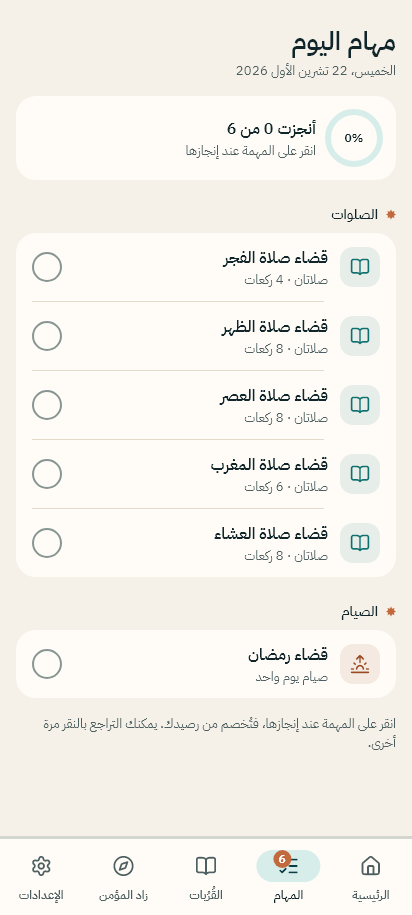
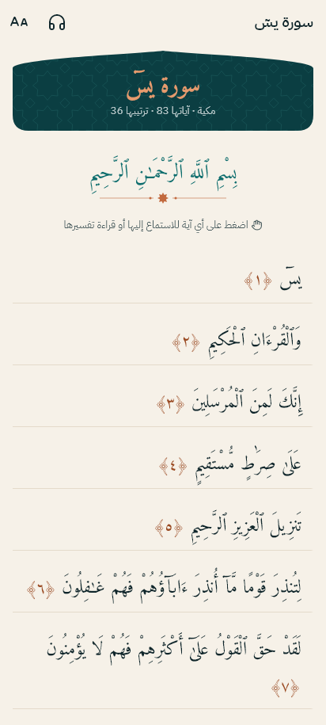
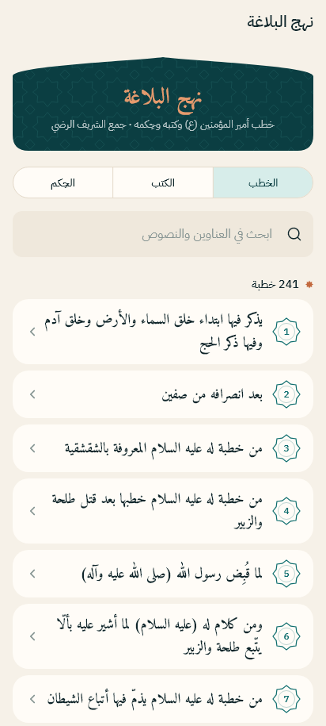
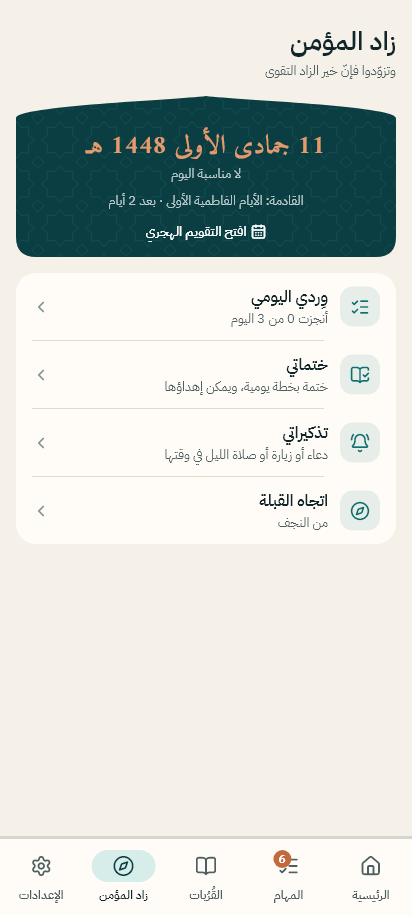
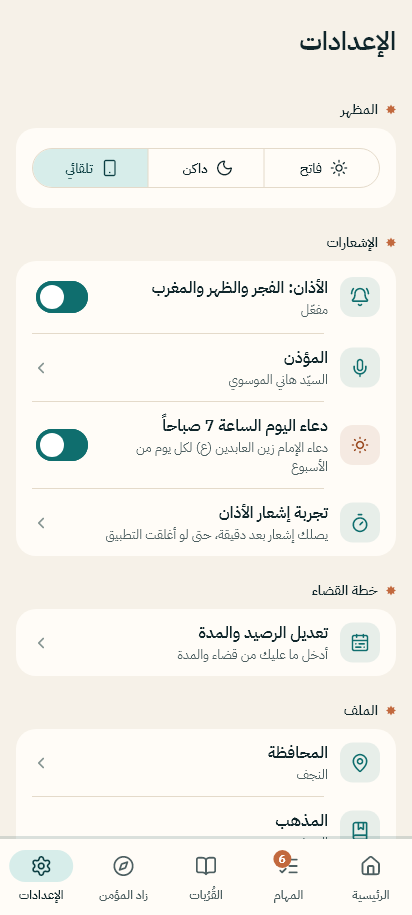

# خُطى السجّاد

**قضاء الصلاة والصيام على نهج الإمام زين العابدين (عليه السلام)**

تطبيق أندرويد يساعدك على قضاء ما فاتك من صلاة وصيام بخطة يومية مريحة وفق المذهب الجعفري، ويجمع معها القرآن الكريم وكتب الأدعية والأذان ومواقيت الصلاة في مكان واحد. يعمل دون إنترنت، وبلا إعلانات ولا حسابات.

## ⬇️ التحميل

حمّل أحدث نسخة من صفحة [الإصدارات (Releases)](../../releases/latest):

| الملف | لمن |
|---|---|
| `khuta-al-sajjad-arm64.apk` | **أغلب الهواتف الحديثة**: ابدأ به |
| `khuta-al-sajjad-armv7.apk` | الهواتف القديمة، إن لم يعمل الملف الأول |

**طريقة التثبيت:** افتح الملف من الهاتف، واسمح بـ«التثبيت من مصادر غير معروفة» إذا طلب الهاتف ذلك.
يحتاج أندرويد 7 أو أحدث.

## 📱 صور التطبيق

  
  
  

  
  
  

  
  

## ✨ المميزات

### قضاء الصلاة والصيام
- تُدخل ما عليك من صلوات وأيام صيام، وتختار المدة التي تناسبك.
- يوزّع التطبيق القضاء على الأيام، فتجد كل صباح مهام اليوم فقط.
- كلما أنجزت مهمة نقص رصيدك تلقائياً، وترى تقدّمك.

### الأذان ومواقيت الصلاة
- مواقيت لكل محافظات العراق وفق المذهب الجعفري، وتعمل دون إنترنت.
- إشعار أذان الفجر والظهر والمغرب حتى والتطبيق مغلق.
- اختيار المؤذن، ومنهم السيد هاني الموسوي.
- دعاء اليوم من أدعية الإمام زين العابدين (ع) كل صباح.

### القُرُبات
- **القرآن الكريم** بالرسم العثماني، مع التلاوة وتفسير شبّر والتبيان وصدر المتألهين، وتكملة القراءة من حيث وقفت.
- **الصحيفة السجادية** كاملة.
- **مفاتيح الجنان** مع البحث فيه.
- **نهج البلاغة**: 241 خطبة و79 كتاباً و470 حكمة، مع البحث في النصوص.
- **أعمال اليوم والأشهر** الهجرية، و**تعقيبات الصلاة**، و**المسبحة**.

### زاد المؤمن
- الوِرد اليومي، والختمات، والتذكيرات.
- اتجاه القبلة، والتقويم الهجري مع المناسبات.

### التصميم
- عربي بالكامل من اليمين إلى اليسار، بخط واضح وزخارف إسلامية هادئة.
- وضع فاتح وداكن وتلقائي، وتكبير الخط للقراءة.

## 🔒 الخصوصية

لا يجمع التطبيق أي بيانات شخصية: كل بياناتك محفوظة على هاتفك فقط، ولا يوجد حساب ولا إعلانات ولا تتبّع.
راجع [سياسة الخصوصية](PRIVACY_POLICY.md).

> يساعدك التطبيق على تنظيم القضاء. للأحكام التفصيلية ارجع إلى مرجع تقليدك.

## 👤 المطوّر

**محمد فاضل غانم العبادي**
للتواصل والاقتراحات: qqqqmmmww217@gmail.com

